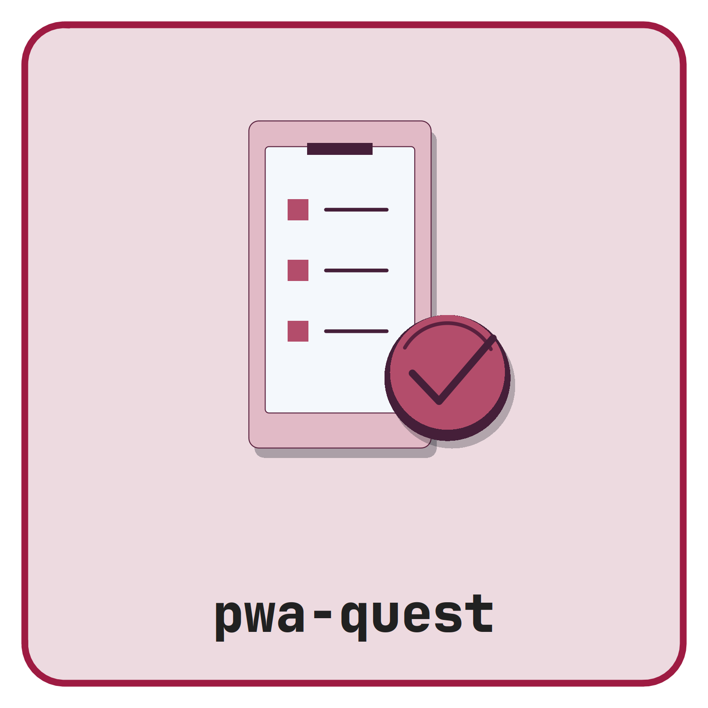

# Questionnaire PWA <picture class="cttir-readme-logo"><source class="cttir-logo-dark-source" media="(prefers-color-scheme: dark)" srcset="assets/branding/logo-with-name-dark.png" /></picture>

An offline-first Progressive Web App for collecting questionnaire responses in
research / field settings. Each session is keyed by a participant ID and a
scenario. After ten questions the app can export the data as a QR code (for
scanning at a central station) or as a JSON / CSV / XLSX / TXT / XML file.

No backend or telemetry receives participant responses. The initial visit and
service-worker update checks contact the static host. Once the production app
has finished caching and its service worker controls the page, it works offline.

## Tech choices

- **React 18 + Vite + TypeScript** — small bundle, fast dev loop, mature PWA
  story via `vite-plugin-pwa` (Workbox).
- **Tailwind CSS** — mobile-first utility classes; high-contrast palette
  designed to remain readable in bright outdoor light.
- **Zustand** — minimal global store; persists the in-progress session to
  IndexedDB so a tab close / reload resumes where the participant left off.
- **html5-qrcode** for camera-based QR scanning. Chosen over @zxing/browser
  because of better out-of-the-box mobile camera handling and a simpler API.
- **qrcode** (npm) for QR rendering on the export screen.
- **xlsx (SheetJS, community build)** for `.xlsx` export, lazy-loaded so it
  doesn't bloat the initial shell.
- **Hand-rolled** CSV / TXT / XML writers — small enough to keep in-tree and
  easier to review than pulling another dependency.

## Develop

Use Node.js 24 and npm. Install the committed lockfile reproducibly:

```bash
npm ci
npm run dev          # http://localhost:5173
```

The service worker is disabled in dev for fast iteration; offline behaviour
must be verified against a production build.

## Production build

```bash
npm run build        # output in dist/
npm run preview      # serve the production build locally on :4173
```

To verify offline:

1. `npm run build && npm run preview`
2. Open the URL in a Chromium-based browser, hit reload once so the service
   worker activates, then go to DevTools → Application → Service Workers and
   tick "Offline" (or pull the network cable). The app should still load and
   complete a session end-to-end.

## Deploy as a static PWA

The build output in `dist/` is plain static files — host it anywhere that can
serve them with the right MIME types and HTTPS.

### Netlify / Vercel / Cloudflare Pages

Point the platform at this repo, set the build command to `npm run build`,
and the publish directory to `dist`. No further config needed.

### GitHub Pages

A workflow at `.github/workflows/deploy.yml` builds and publishes the site
on every push to `main` or on manual dispatch.
It builds with `BASE_PATH=/<repo-name>/` so asset URLs resolve correctly
from the sub-path host.

One-time setup in the repository:

1. **Settings → Pages → Build and deployment → Source**: select
   **GitHub Actions**.
2. Push to a covered branch (or use **Run workflow** on the Actions tab).

The deployed URL is `https://<owner>.github.io/<repo-name>/`. HTTPS is on
by default, which the service worker requires.

To build and publish manually with a different host:

```bash
BASE_PATH=/pwa-quest/ npm run build
# then upload dist/ to your static host
```

## Customising the questionnaire

All content lives in `src/config/`:

- `questionnaire.ts` — the array of ten questions. Each question has a
  stable `id` that ends up in exports; renaming an `id` invalidates any
  in-progress sessions on participants' devices, so prefer adding new items
  and bumping `SCHEMA_VERSION` for breaking changes.
- `scenarios.ts` — the dropdown options for "scenario". Edit the array to
  match your study; the scenario field on the setup screen is locked to
  these values to keep exported data clean.

The full set of question types is defined in `src/types.ts` (`QuestionType`).
Add a new type by extending that union, adding a component under
`src/components/questions/`, and wiring it up in `QuestionRenderer.tsx` and
`lib/answers.ts`.

## QR code limits (export)

The export QR encodes the session as compact JSON. With error correction
level **M**, a QR code can hold roughly 2,300 alphanumeric characters or
~1,800 byte-mode characters in practice — but scannability degrades as the
code approaches that limit, especially on cheaper phone cameras.

The app warns when the JSON exceeds **2,000 UTF-8 bytes** and recommends the
file download instead. Multi-QR chunking is intentionally **not** supported
— scanning chunked codes in the field is fiddly, and the file downloads
already cover this case. If you need it, open an issue.

To stay well under the limit:

- Keep free-text answers short (the example questionnaire caps `q7` at 80
  chars and marks `q8` optional).
- Use stable, short scenario IDs.
- Question IDs (`q1`..`q10`) are already short — don't rename them to longer
  strings.

## File exports

Filename pattern:
`questionnaire_<participantId>_<scenario>_<YYYYMMDD-HHmm>.<ext>`. Both fields
are sanitised — anything outside `[A-Za-z0-9_-]` is collapsed to `-`.

| Format | Notes                                                                |
| ------ | -------------------------------------------------------------------- |
| JSON   | Exact canonical session, including typed answers and all metadata; preferred archival format. |
| CSV    | One row per answer. RFC 4180 quoting. UTF-8 BOM for Excel on Windows.|
| XLSX   | Two sheets: `Session` (key/value metadata) and `Answers` (CSV-shape).|
| TXT    | Human-readable — header block, then `Q/A` pairs.                     |
| XML    | Well-formed, single `<session>` root, escaped attribute/element data.|

CSV cells beginning with a spreadsheet formula prefix (`=`, `+`, `-`, or `@`,
including after whitespace) receive a leading apostrophe to prevent execution.
This changes their CSV text; use JSON for exact values. XLSX writes answers as
literal text cells. Flat formats join multiple selections with `|`; JSON keeps
the array structure. XML refuses XML 1.0-invalid characters rather than silently
removing response content. Export errors preserve the current session for retry.

## Saved sessions and recovery

Use one tab per device and participant. Storage is local to this browser and
origin; it is not encrypted, synchronized, or a backup. Export before clearing
site data or handing the device to another participant. Browser eviction or
private browsing can remove local storage.

Saved drafts are validated and bound to the exact questionnaire and scenario
configuration. Any wording, options, order, or schema change blocks incompatible
resume without deleting the saved value. Restore the matching app version to
recover it, or explicitly confirm clearing it. Valid drafts from the original
unversioned app remain readable while that original configuration is unchanged.
A persistent storage error provides a retry action. A failed clear does not
pretend the participant's data was removed.

## Checks

```bash
npm test
BASE_PATH=/pwa-quest/ npm run build
npx playwright install chromium
npm run test:browser
npm audit --omit=dev
```

The browser test exercises the production service worker, an offline questionnaire,
reload/resume, all download formats and durable clearing using synthetic answers.
Physical camera scanning and native mobile sharing still require device checks.
The example instrument is not a scientifically validated questionnaire.

## Licensing

No repository-wide license has been specified. Public GitHub visibility alone
does not grant general redistribution permission; the maintainer must choose
and document a license before an open-source release. Third-party dependencies
retain their own licenses.

## Project layout

```
src/
  components/
    questions/    # one component per question type
    qr/           # QrScanner.tsx, QrDisplay.tsx (lazy)
    ui/           # Progress, Modal, Toast
  config/
    questionnaire.ts
    scenarios.ts
  lib/
    storage.ts        # IndexedDB wrapper
    sanitize.ts       # filename helpers
    answers.ts        # default + validation per type
    buildSession.ts   # build the canonical export object
    download.ts       # browser download helper
    export/
      csv.ts | txt.ts | xml.ts | xlsx.ts
  pages/
    Setup.tsx | Questionnaire.tsx | Review.tsx | Export.tsx
  pwa/
    registerSW.ts
  App.tsx
  main.tsx
  styles.css
public/
  favicon.svg
  icons/icon.svg + generated PNGs
```

## Privacy

The app is fully client-side. The only camera usage is the optional setup-QR
scan; the stream stops as soon as a code is decoded. No data ever leaves the
device unless the operator chooses to share an exported file or QR code.

## Re-generating PWA icons

The editable R geometry in `tools/branding` is the source of the PWA icons.
The committed PNGs include a maskable icon with an opaque background and
the complete symbol inside the safe circle. Regenerate registered assets with:

```sh
Rscript tools/branding/render.R --apply
```

`node scripts/build-icons.mjs` runs the same R renderer. R with Cairo graphics
is needed only when regenerating artwork. Commit the resulting assets.

## Use of LLM tools

Where applicable, LLM tools were used for narrowly defined, non-authorial tasks:
copyediting, prose refinement, Markdown/LaTeX formatting, boilerplate scaffolding
(such as CI configurations and build scripts), and code refactoring. Tools included
[Chat AI](https://kisski.gwdg.de/leistungen/2-02-llm-service/), the KISSKI
(GWDG) service, and self-hosted **Mistral Small (24B, Apache-2.0)** served through
a local **vLLM architecture** on an Ubuntu Linux workstation with Intel
processors and NVIDIA GPUs. The self-hosted model ran locally, with no data sent
to third parties.

All scientific claims, methodological choices, analyses, interpretations and
conclusions remain the authors' own. Where applicable, LLM-generated material
must be reviewed and revised before inclusion, and references must be verified
against their DOI, arXiv ID or ISBN.

Local software setup: vLLM with Python/PyTorch, plus R and RStudio.

## Branding

The supplied CTTIR Coder Edition v5 artwork and its editable R source are in
[`tools/branding`](tools/branding/README.md). Use that renderer to reproduce
the primary badge, alternate editions, and platform icons.
